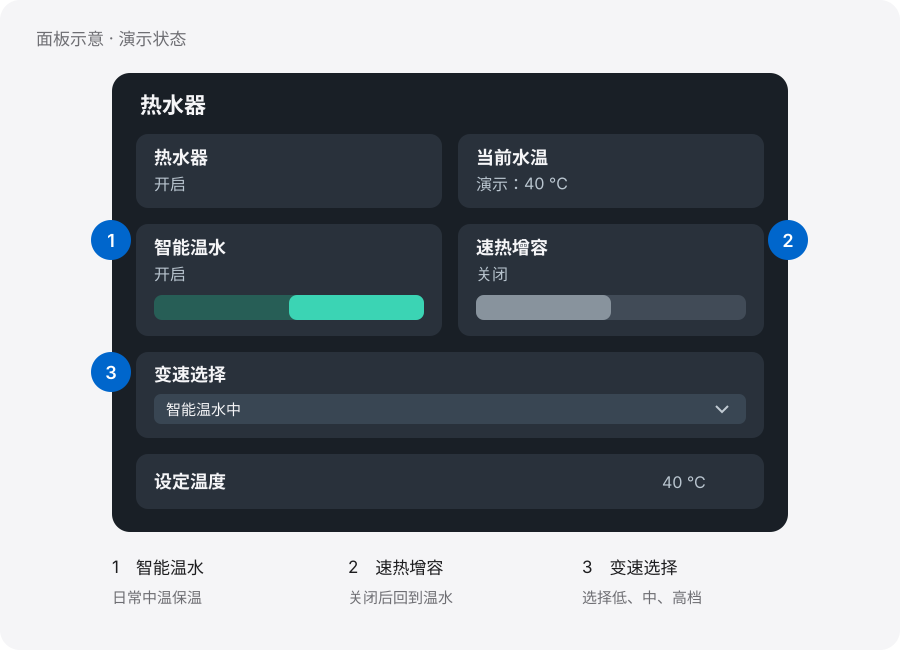
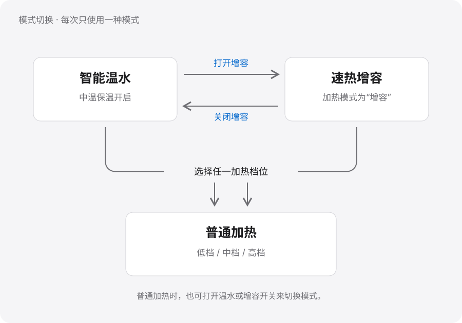

# 海尔热水器控制面板

在 Home Assistant 中使用智能温水、速热增容和低、中、高档选择。原生磁贴，真实状态反馈，无需额外安装前端卡片。

**[阅读图文使用手册](https://SvenRogue.github.io/haier-water-heater-dashboard/)** · [下载 PDF 说明书](docs/haier-heater-guide-v1.1.0.pdf) · [纯文本手册](docs/guide.md)



## 开始使用

先阅读[使用前准备](docs/guide.md#prepare)，核对设备实体和模式行为，再按[安装步骤](docs/guide.md#install)配置。

| 文件 | 用途 |
| --- | --- |
| [热水器配置](packages/haier_heater.yaml) | 速热增容与档位选择模板 |
| [面板配置](dashboards/heater.yaml) | 独立仪表盘或现有总览中的热水器模块 |
| [图文手册](https://SvenRogue.github.io/haier-water-heater-dashboard/) | 安装、操作、图示和故障排查 |

配置中的 `example_heater` 是占位符，使用前需要替换。请先开启热水器总开关，再使用模式控制。

## 三种模式如何工作

- **智能温水：**直接使用设备的中温保温开关。
- **速热增容：**开启增容模式；关闭后回到智能温水。
- **变速选择：**选择低、中或高档，进入普通加热。



这些模式互斥。温水或增容模式下，原生功率值可能为空；面板会显示当前模式，不会将空值强行填成高档。设备真正离线时仍显示不可用。

## 兼容范围

现场观察的型号为 EC6002-MG(U1)，集成为 [banto6/haier](https://github.com/banto6/haier)，配置语法按 Home Assistant Core 2026.6.3 校验。

示例依赖原生“增容”选项及设备自动退出其他模式的行为。不同型号需先与海尔智家 App 对照验证，不能直接假定映射相同。原生功率选项名称也不等于已验证的实际瓦数。

现场实现已用真实设备回报验证；仓库中的通用 YAML 另做了目标版本校验和离线测试。参见[验证记录](docs/VERIFICATION.md)。

## 离线验证

```sh
python -m pip install -r requirements-dev.txt
python tools/validate.py
```

验证覆盖模式、档位映射、离线处理、布局及明显的敏感信息格式，不连接家庭设备。

如需修改说明书，编辑 [手册正文](docs/guide.md)，再运行：

```sh
python tools/build_manual.py
```

生成的 [独立 HTML 手册](docs/index.html) 内嵌全部图示，可下载后离线阅读，也可在浏览器中打印。

## 隐私与许可

本项目只发布脱敏范例。未包含真实账号、令牌、地址、设备唯一标识、完整家庭总览或原始截图；图示均为合成演示。详见[脱敏说明](docs/PRIVACY.md)。

采用 [MIT 许可](LICENSE)。与海尔、Home Assistant 及 Apple 官方均无隶属关系。
