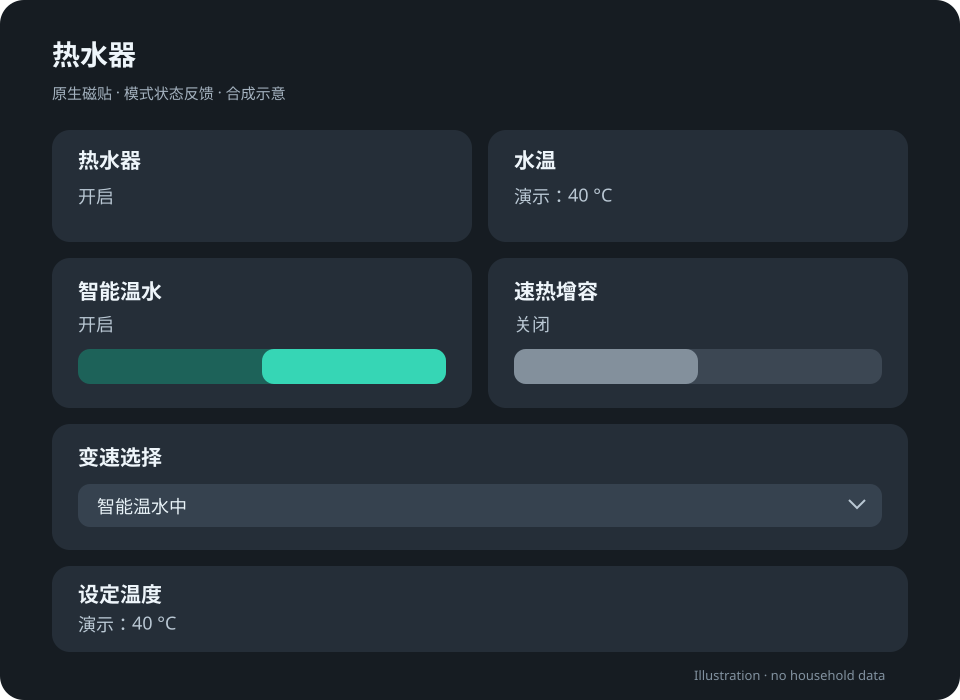

# 海尔热水器 · Home Assistant 控制面板

用于海尔热水器的原生 Lovelace 磁贴示例：**智能温水、速热增容、变速选择**。通过真实设备状态处理互斥模式，避免将当前未启用的功率档位误判为离线。



本项目提供脱敏后的配置范例，不包含完整家庭总览、原始截图、设备注册表、认证数据或诊断脚本。

## 实际解决的问题

在一台 EC6002-MG(U1) 上，海尔智家 App 与 HA 的实时状态对照显示：

| 模式 | 中温保温 | 加热模式 | 功率档位 |
|---|---|---|---|
| 智能温水 | 开 | 空值 | 空值 |
| 速热增容 | 关 | `增容`，云端值 `3` | 空值 |
| 普通加热 | 关 | 空值 | 云端值 `1` / `2` / `3` |

`heatingModeSupported` 和 `powerSettingSupported` 会随模式变化。它们为 false，不能单独证明机器永久不支持这个功能。功率值为空，也不应被强行填成高档。

- **智能温水**直接使用集成提供的中温保温开关。
- **速热增容**开启时选择真实的 `增容` 选项；关闭时回到智能温水。
- **变速选择**提供低、中、高档。处于其他模式时显示“智能温水中”或“速热增容中”，选择档位即可进入普通加热。

这是针对已观察协议行为的示例，不保证所有型号一致。先对照自己的 App 与实时状态确认映射。

## 前提

- 已安装并配置 [banto6/haier](https://github.com/banto6/haier)，原生设备实体正常更新。
- 配置语法按 Home Assistant Core **2026.6.3** 校验。
- 使用原生 `sections`、`tile`、`toggle`、`select-options`，不需要 Mushroom、card-mod 等前端卡片。
- 手动控制设备属于可选的安装验证；本仓库的验证脚本完全离线，不连接家庭设备。

## 安装

1. 在 **开发者工具 → 状态**中找到自己的实体，对照下表替换两个 YAML 文件中的占位 ID。不要填写账号密码或令牌。

   | 占位实体 | 应替换为 |
   |---|---|
   | `switch.example_heater_onoffstatus` | 热水器总开关 |
   | `switch.example_heater_heatkeepingstatus` | 中温保温功能开关 |
   | `select.example_heater_heatingmode` | 加热模式选择 |
   | `select.example_heater_power` | 功率设定选择 |
   | `sensor.example_heater_currenttemperature` | 当前水温 |
   | `sensor.example_heater_targettemperature` | 目标温度 |

2. 检查原生功率选择实体的 `options`。示例中的 `800W(低)`、`1200W(中)`、`2000W(高)` 是集成返回的**选项字符串**，并非本项目对实际功率的认定。如果你的选项不同，必须同步修改配置中的状态映射、可选值判断与动作映射。面板只显示低、中、高档，不展示未经校验的瓦数。

   同时确认原生加热模式的 `options` 含精确的 `增容`，且从 App 操作可验证选择增容或功率档位会自动退出其他模式。本示例依赖这种**设备原生互斥**，没有通用地强行关闭其他模式。选项名或行为不同的型号，需要相应调整状态判断与控制动作。

3. 将 [热水器配置](packages/haier_heater.yaml) 复制为 HA 配置目录中的 `packages/haier_heater.yaml`。把下面一行合并进**已有**的 `homeassistant:` 块；保留其中其他设置：

   ```yaml
   homeassistant:
     packages: !include_dir_named packages
   ```

   `packages:` 应位于 `homeassistant:` 下，**不能放到配置顶层**，也不要创建第二个 `homeassistant:` 块。如果已经使用 packages，无需重复添加。

4. 先使用 HA 的配置检查，再重启 HA 以加载新增的 packages 设置。若之前已经启用 packages，可使用“模板实体重新加载”。

5. 确认生成了 `switch.haier_heater_boost` 和 `select.haier_heater_speed`。若同名 ID 已被占用，HA 可能追加数字后缀，按实际 ID 修改面板引用。英文实体名用于让默认 ID 更可预测，卡片显示中文。

6. 将 [面板配置](dashboards/heater.yaml) 用作独立 YAML 仪表盘，或只把 `views[0].sections[0].cards` 的内容复制进现有 Sections 视图的一列中。无需替换整个家庭总览。

   独立 YAML 仪表盘可在已有的 `lovelace.dashboards` 中合并以下条目，不要覆盖其他仪表盘：

   ```yaml
   lovelace:
     dashboards:
       dashboard-heater:
         mode: yaml
         title: 热水器
         icon: mdi:water-boiler
         show_in_sidebar: true
         filename: dashboards/heater.yaml
   ```

   新注册仪表盘后需要重启 HA。前端仍显示旧内容时再刷新页面。

## 验证与限制

本项目对应的现场实现使用 HA 正式助手配置流程创建，已通过真实设备回报验证：温水开关、增容开启、增容关闭回温水，以及低、中、高档切换。测试后恢复了当时的原始模式。仓库中的 YAML 是同一行为的可复用版本，已做目标版本 schema 校验与离线模式测试；不能把它视为已在所有设备安装验证。

- 进入增容或普通加热时，设备可能同时更改目标温度；以设备实际回报和 App 行为为准。
- 关闭增容是**返回智能温水**，并不是关机或恢复先前的普通加热档位。
- 空值与离线分开处理；设备失联时控件仍应显示不可用。
- 示例不自动打开热水器总电源；请先开启总开关后使用模式控制。
- 不手工编辑 `.storage`，不伪造注册表实体，不提交令牌或账号。
- 不依据 `restore_state` 的历史值或 HTTP 首页返回成功判定控制可用；应核对实时实体，并确认设备状态确实变化。

离线检查：

```sh
python -m pip install -r requirements-dev.txt
python tools/validate.py
```

验证脚本检查 YAML 结构、布局行宽、三个互斥模式、各档位命令映射、离线处理及明显的敏感信息格式；不会调用 HA 或控制设备。

## 发布内容与隐私

参见 [脱敏说明](docs/PRIVACY.md) 和 [验证记录](docs/VERIFICATION.md)。预览图为合成示意，不是家庭实拍或真实 HA 截图。

## 许可

[MIT](LICENSE)。此项目与海尔及 Home Assistant 官方无隶属关系。
